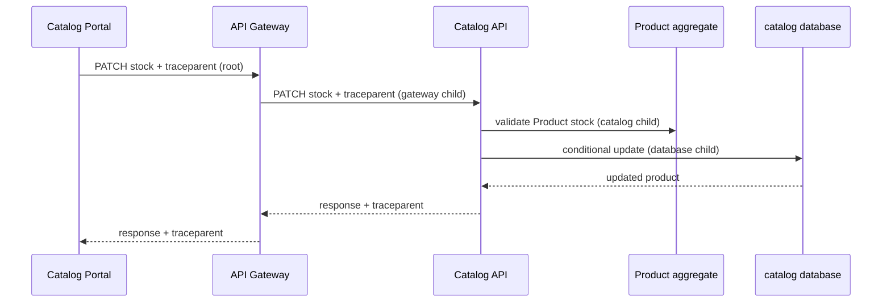

# CP1 — Catalog stock update trace map

## Critical journey

An administrator changes the available stock of one `Product`. The Catalog Portal calls the public API Gateway route; the gateway forwards only the public admin route to Catalog API. Catalog API validates the `Product` invariant and persists the new stock in the catalog database.

| Step | Caller | Callee | Protocol | Operation | Mode | Trace context |
|---|---|---|---|---|---|---|
| 1 | Catalog Portal | API Gateway | HTTPS | `PATCH /api/v1/admin/products/{id}/stock` | sync | `traceparent` created by the portal |
| 2 | API Gateway | Catalog API | HTTP | same route, `catalog-api:8082` | sync | gateway creates a child span and forwards `traceparent` |
| 3 | Catalog API | `Product` aggregate | in-process | validate requested stock | sync | current span remains active |
| 4 | Catalog API | catalog database | MongoDB | conditional product update | sync | database child span carries the same trace ID |

## Span tree

- `catalog-portal.update-stock` — root span; trace ID is created by the portal.
  - `api-gateway.route-catalog-admin` — HTTP server span.
    - `catalog-api.patch-product-stock` — HTTP server span.
      - `product.validate-stock` — in-process validation span.
      - `catalog-db.conditional-stock-update` — MongoDB client span.

This read/write journey has no asynchronous broker hop. If stock changes later publish an event, the message headers must carry the same `traceparent` trace ID with a new producer span.

## Trace and correlation compatibility

The existing gateway propagates `X-Correlation-Id`. This workshop preserves it as the human-searchable `correlation_id` and derives the W3C `trace_id` from `traceparent`, allowing the current error envelope and the proposed distributed trace to be queried together.
