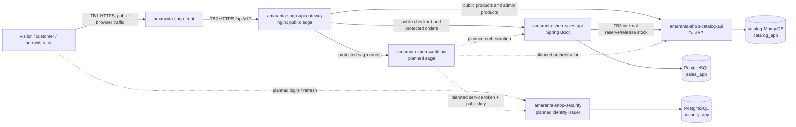

# Amaranta Shop attack surface and trust boundaries

## Real v1 data flow

**Owned boundary:** TB2, from the browser/front application to the nginx public
edge. TB1 is shown because a browser controls everything it sends to the Front;
TB3 is shown because it is intentionally outside the public Gateway surface.

## Current scope versus planned components

`catalog-api`, `catalog-db`, `sales-api`, `sales-db`, and the Gateway have an
implemented v1 contract. `workflow` and `security` are skeleton/design
repositories: dashed edges identify planned communication, not a claim that it
runs today. The `worker` repository contains no declared queue, topic, or
external provider in its current contract, so no broker boundary is invented in
this map. No external payment API belongs to the current v1 checkout scope.

## Asset inventory

| Asset | Where it exists or crosses | Classification |
|---|---|---|
| Product catalogue, prices, and in-stock flag | Catalog API and MongoDB; `GET /api/v1/products*` | Public |
| Product administration and stock mutation | Catalog API and MongoDB; `/api/v1/admin/products*` | Restricted |
| Order lines, contact name, phone, delivery address | Sales API and PostgreSQL; `POST /api/v1/orders` | Confidential |
| JWT public key, access claims, refresh-token hash | Security service and `security` schema | Restricted |
| Correlation id, trace id, request outcome | Gateway and service logs | Internal |
| Catalog stock reservation/release | Sales-to-Catalog internal endpoints | Restricted |

## Entry points at the owned boundary

| Entry point | Caller | Authentication today | Boundary decision |
|---|---|---|---|
| `GET /api/v1/products*` | Browser | None | Public route to Catalog only |
| `POST /api/v1/orders` | Browser visitor or customer | Optional; a malformed supplied token must fail in Sales | Public checkout route to Sales only |
| `GET /api/v1/orders*` | Browser customer/staff | Gateway requires header; Sales verifies JWT | Protected route |
| `/api/v1/admin/products*` | Browser administrator | Gateway requires header; Catalog verifies JWT and `ADMIN` | Protected route |
| `/api/v1/sagas/*` | Browser staff, once Workflow exists | Gateway requires header; Workflow must verify JWT | Protected planned route |
| `/internal/products/*` | Not a browser caller | Never published by the Gateway | Must return `404` at TB2 |
| `GET /health` | Browser/monitor | None | Gateway health only |

## Boundary controls evidenced today

- The Gateway names only explicit public locations; path lookalikes such as
  `/api/v1/productsx` are not routed.
- `/internal/*` is blocked for direct, traversal, and encoded-path attempts.
- Protected routes without an `Authorization` header receive the shared `401`
  envelope. A present token is passed to the owning service for actual
  validation.
- CORS accepts the configured front origin, and an unknown origin receives no
  allow grant.
- The Gateway sanitizes or creates `X-Correlation-Id` and applies a public-edge
  rate limit before proxied upstream traffic.
