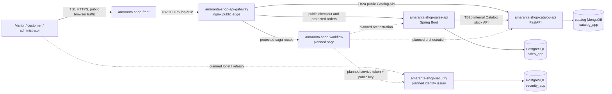

# Amaranta Shop attack surface and trust boundaries

## Real v1 data flow

**Owned boundary:** TB2a and TB2b are the inbound Catalog API boundary split by
direction: Gateway forwards the public and administrator product routes, while
Sales calls the internal stock routes. TB1 is shown only to establish that a
browser controls every public request before it reaches the platform.

## Current scope versus planned components

`catalog-api`, `catalog-db`, `sales-api`, `sales-db`, and the Gateway have an
implemented v1 contract. `workflow` and `security` are skeleton/design
repositories: dashed edges identify planned communication, not a claim that it
runs today. The `worker` repository contains no declared queue, topic, or
external provider in its current contract, so no broker boundary is invented in
this map. No external payment API belongs to the current v1 checkout scope.

## Asset inventory

| Asset | Where it exists or crosses | Classification |
|---|---|---|
| Product catalogue, prices, and in-stock flag | Catalog API and MongoDB; `GET /api/v1/products*` | Public |
| Product administration and stock mutation | Catalog API and MongoDB; `/api/v1/admin/products*` | Restricted |
| Order lines, contact name, phone, delivery address | Sales API and PostgreSQL; `POST /api/v1/orders` | Confidential |
| JWT public key, access claims, refresh-token hash | Security service and `security` schema | Restricted |
| Correlation id, trace id, request outcome | Gateway and service logs | Internal |
| Catalog stock reservation/release | Sales-to-Catalog internal endpoints | Restricted |

## Entry points at the owned boundary

| Entry point | Caller | Authentication today | Boundary decision |
|---|---|---|---|
| `GET /api/v1/products*` | Gateway on behalf of a browser | None | Public Catalog read |
| `/api/v1/admin/products*` | Gateway on behalf of an administrator | Gateway requires header; Catalog verifies JWT and `ADMIN` | Restricted Catalog mutation/read |
| `POST /internal/products/reserve-stock` | Sales API | Network-only trust today | Internal all-or-nothing stock reservation |
| `POST /internal/products/release-stock` | Sales API | Network-only trust today | Internal compensation of a prior reservation |
| `GET /health` | Gateway or monitor | None | Catalog health only |

The browser cannot call `/internal/products/*`: the Gateway must return `404`
for direct, traversal, or encoded attempts. That protection is not equivalent to
authenticating Sales to Catalog, which is why the internal route is a separate
P0 concern in the STRIDE analysis.

## Boundary controls evidenced today

- The Gateway names only explicit public locations; path lookalikes such as
  `/api/v1/productsx` are not routed.
- `/internal/*` is blocked for direct, traversal, and encoded-path attempts.
- Protected routes without an `Authorization` header receive the shared `401`
  envelope. A present token is passed to the owning service for actual
  validation.
- CORS accepts the configured front origin, and an unknown origin receives no
  allow grant.
- The Gateway sanitizes or creates `X-Correlation-Id` and applies a public-edge
  rate limit before proxied upstream traffic.
